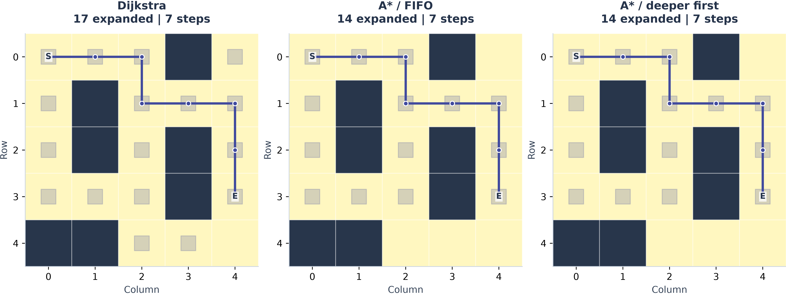
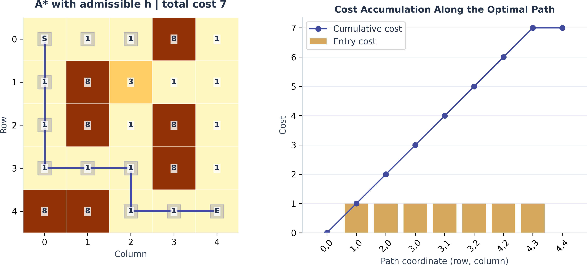
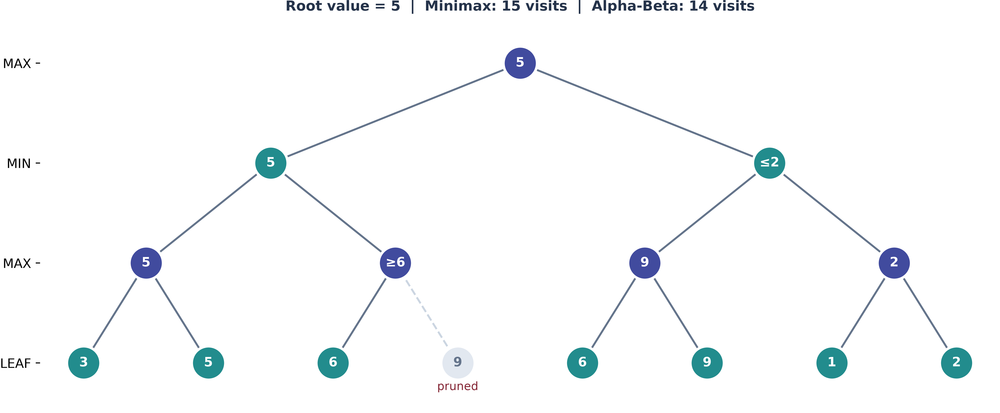
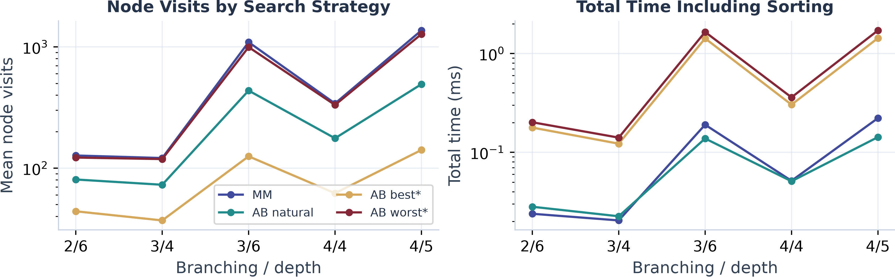
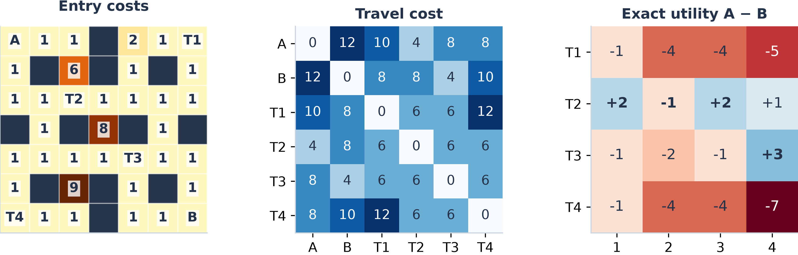
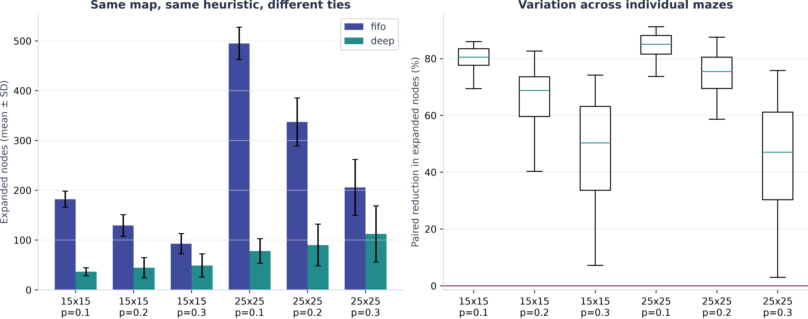
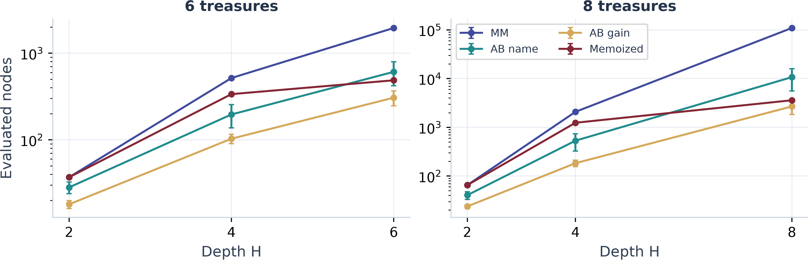

# 实验二：A\*与Alpha-Beta搜索算法

仓库地址：[https://github.com/Qiuxulan/Contemporary-Artificial-Intelligence_26Fall.git](https://github.com/Qiuxulan/Contemporary-Artificial-Intelligence_26Fall.git)

## 1 实验目标与概述

本次实验实现A\*、Minimax和Alpha-Beta三种搜索算法，并用它们完成迷宫寻路、加权地形、博弈树和竞争取宝四个任务。报告第2节说明算法设计和实验设置；第3–6节依次对应Task 1–4，阐述基础结果和形成逻辑，并记录一些思考和分析；第7节集中是设计的优化和拓展实验，在样例之外设计对照实验，看启发函数、并列处理、访问顺序和缓存的结果并针对性分析；第8节总结。

## 2 算法设计与实验设置（具体分析见下一节）

### 2.1 A\*的状态、代价与优先队列

A*以坐标(row, col)为状态，每次向上下左右移动，用f(n)=g(n)+h(n)确定搜索优先级。g是已付出的代价，h是预计剩余代价：Task 1按步数累计，采用曼哈顿距离；Task 2按进入格的权值累计，终点进入免费，因此需要修正启发下界。

实现采用最小堆，按f值、并列策略和生成顺序取出节点；发现更小的g时更新父指针并重新入堆，跳过旧条目，必要时重新开放已扩展节点。终点弹出后沿父指针恢复路径。对于非负边权，在启发函数可采纳、终点启发值为0且允许重新开放的条件下，标准A*保证最优；令h=0则退化为Dijkstra，作为正确性和效率对照。

### 2.2 Minimax与Alpha-Beta的递归

Minimax从根节点开始，MAX节点取子节点的最大值，MIN节点取最小值，叶子直接返回给定得分。Alpha-Beta在递归时多带两个参数：α是MAX一方已经能保证的最低值，β是MIN一方已经能保证的最高值。处理MAX节点时，如果当前值已经 `≥β`，上层的MIN肯定不会让局面走到这里，其余子节点就不必再算；MIN节点则在当前值 `≤α` 时截断。两种算法在相同树和相同深度下返回同一个根值，剪枝只改变访问的节点数。

### 2.3 综合题的状态建模

Task 4把前两种算法接在一起。先用A\*算出A、B、T1–T4六个关键点两两之间的最小移动代价，得到距离矩阵；然后博弈中每一轮只需要"选一个剩余宝藏"，移动代价直接查表。状态记为 `(pos_A, pos_B, R, score_A, score_B)` 加上当前行动方，`R`是剩余宝藏集合。取宝藏Ti的收益为 `Gain=V_i−d(p,T_i)`，评价函数 `U=Score_A−Score_B`，A希望U大，B希望U小。具体的建模细节放到第6节。

### 2.4 实验设置

下面的对照实验遵守：同一张地图或同一棵树上比较不同方法，只改变当前要研究的那一个因素；每个结果都经过与Dijkstra或完整Minimax核对。基础随机种子为42。

| 实验组    | 输入                                            | 对比的方法                               | 记录数 |
| --------- | ----------------------------------------------- | ---------------------------------------- | ------ |
| heuristic | 100张20×20权值图（1–9）                       | Dijkstra、曼哈顿、修正下界A\*、w=1.5/2/3 | 600    |
| tiebreak  | 边长15/25，障碍密度0.1/0.2/0.3，各100张连通迷宫 | 同f时FIFO与deep                          | 1200   |
| ordering  | 5组分支数/深度，各30棵随机树                    | Minimax、AB自然序、Oracle最好序/最坏序   | 600    |
| game      | 题目给定的7×7四宝藏，H=1–4                    | Minimax、AB名称序、AB收益序、精确缓存    | 16     |
| scale     | 12×12地图，6/8个宝藏各8张，H=2/4/完整深度      | 同上四种方法                             | 192    |

表中对照共2608条记录，仓库的 `results/experiment_results.csv`保留全部2708条原始记录，包含报告未展开的其他尝试。计时先预热1次，再重复搜索3次取中位数，包含算法初始化和搜索，不包含地图生成、结果核验和绘图；多张地图的结果用均值±样本标准差表示。博弈方法共用同一张距离矩阵，其构建时间不计入。

输入输出按题目格式设计：题一返回坐标列表（无解为空列表），题二返回int（无解为−1），题三可直接读入题目的JSON树，题四返回 `{"best_target", "best_value"}`，接口在 `src/search/api.py`，由 `main.py` 核对。代码结构、运行命令和依赖版本见 `README.md`，完整分组结果见 `results/results.md`，原始记录见 `experiment_results.csv`。

## 3 Task 1：迷宫寻路

### 3.1 最短路径是怎样形成的

起点 `(0,0)`，终点 `(3,4)`，只能进入非 `X` 的格子。运行得到的路径是 `(0,0)→(0,1)→(0,2)→(1,2)→(1,3)→(1,4)→(2,4)→(3,4)`，共8个坐标、7步，与题目的预期相同。

沿这条路径，`g`依次为0、1、2、3、4、5、6、7，`h`依次为7、6、5、4、3、2、1、0，`f=g+h`始终为7。每走一步，已付出的代价增加1，预计剩余步数恰好减少1。起点的曼哈顿下界为7，实际路径也只有7步，达到下界，因此可以确认路径最短。曼哈顿距离不考虑障碍，**不会高于真实剩余步数（可采纳）**；相邻格子的曼哈顿距离最多相差1，**也满足一致性**，因此每个位置第一次被扩展时，对应的 `g`就已经最小，终点弹出时得到的路径一定最短。

### 3.2 h=0与曼哈顿距离的对比

把启发函数换成 `h=0`（Dijkstra）再跑一次，两者得到的路径同样是7步，但Dijkstra扩展了17个节点，A\*只扩展了14个，少17.65%。

差别从扩展顺序上可以看清。A\*扩展的14个节点，`f`全部等于7，也就是等于最优代价；Dijkstra多扩展的3个节点是 `(4,2)`、`(0,4)`、`(4,3)`，它们的 `f` 都是9，都超过了最优代价7。Dijkstra只看 `g`，会把离起点同样近的所有位置先展开，包括朝着错误方向的节点；A\*把终点方向的信息加进 `f`，`f` 大于最优代价的节点就一直排在堆的后面，直到终点先被弹出。**在启发函数一致的前提下，A\*不会扩展 `f>C*` 的节点，而Dijkstra会把 `g` 不超过 `C*` 的节点基本都展开**。启发函数越准，二者之间的差距越大。

这里A\*扩展了14个节点，比最终路径的8个坐标多。原因是起点附近有很多 `f` 同样等于7的候选，比如 `(1,0)`、`(2,0)`、`(3,0)`、`(3,1)`、`(3,2)`、`(2,2)` 都在某条长度为7的路线上，它们的 `f` 与路径上的节点并列，这些候选是否在终点前被扩展，**取决于同f时的访问顺序**。本次按FIFO顺序先处理了其中一部分，并不意味着它们都必须访问。根据这个现象我补充了第7.1节的并列处理实验。

## 4 Task 2：加权地形

### 4.1 路径代价的累计过程

题目二中，每次移动的代价是进入目标格的权值，进入终点E的代价为0，起点不计初始费用。得到的最优路径是 `(0,0)→(1,0)→(2,0)→(3,0)→(3,1)→(3,2)→(4,2)→(4,3)→(4,4)`，最小总代价为7。8次移动的进入代价依次为1、1、1、1、1、1、1、0，累计代价 `g`依次为1、2、3、4、5、6、7、7。逐步累计如下图所示。

这条路线沿左边界下行再向右，避开了权值为8的格子，步数并不比其他路线少，但总代价最小。**说明Task 1里最短步数就是最小代价这里不再成立**。修正下界的A\*扩展11次，Dijkstra扩展15次，两者代价都是7。

### 4.2 终点E的免费规定与启发函数的可采纳性

直接沿用Task 1的曼哈顿距离 `h=|Δr|+|Δc|` 会出问题。以E左边的 `(4,3)` 为例：曼哈顿距离是1，但进入E的代价是0，剩余代价也是0，所以 `h=1>h*=0`，高估了。到达 `(4,3)` 时 `g=7`，若用原始曼哈顿，此处 `f=7+1=8`，已经超过最优代价7。

出现这个问题的根源在于：**每一步至少付出 `c_min`**（地图中除终点外的最小进入代价），但最后一步进入终点是免费的。所以我把启发函数改成 `h(n)=c_min·max(Manhattan(n,E)−1, 0)`，也就是把最后那免费一步扣掉，其余每一步仍按最小代价估计。这个估计不会高估，因此保证最优；`c_min=0`（存在零权格）时，它自然退化为0。样例里修正前后都得到7，扩展次数也都是11。我另外用随机图验证了：测试覆盖了零权、浮点权和障碍的80张随机加权图，与独立实现的Dijkstra逐一核对，结果全部一致。

而原始曼哈顿在100张20×20权值图上也全部得到最优路径（`C/C*`均为1.000）。但结果正确不能反推启发函数可采纳。可能是随机地形中的较高权值使实际剩余代价大于曼哈顿估计，**减弱了免费终点造成的高估影响**。这种实验表现不能保证其他地图上仍然最优，因此最终采用扣除免费一步的修正下界。

### 4.3 一致性与节点重新开放

实际上可采纳还不够，去重时也需要小心。我构造了一个小图，S→A代价3，S→B代价1，B→A代价1，A→G代价2，启发值取 `h(S)=4, h(B)=3, h(A)=h(G)=0`。这些都没有高估，**但B到A的变化不满足一致性**。搜索先以 `g=3` 扩展A，之后才发现经过B到A的 `g` 可以降为2。若已扩展的节点不再处理，就会保留代价5的旧路线；而允许重新开放A，就能找到代价4的 `S→B→A→G`。所以去重不能只看这个位置是否访问过，还要看到达代价有没有改善。

## 5 Task 3：Minimax与Alpha-Beta剪枝

### 5.1 数值回传与剪枝依据

Alpha-Beta从左到右处理时，左MIN先算出第一个MAX子树的值5，所以它的 `β=5`。处理第二个MAX子树时，读到叶子6，当前值已经 `6≥β=5`：这个MAX节点的最终值至少是6，而它的父节点MIN已经有了值为5的选择，不可能再选一个更大的，所以剩下的叶子9就不用看了。这就是剪枝的依据，即**一旦某个节点的值已经确定不会改变父节点的决定，余下的兄弟节点就可以跳过**。Minimax访问15个节点，Alpha-Beta访问14个，少1个（主要因为这棵树太浅，能剪的地方很少）。图3标出了这个过程：

### 5.2 不同访问顺序的搜索开销

样例太小，看不出顺序的影响，所以我生成了随机树来比较。设5组分支数b和深度d，每组30棵树，叶子取值在−99到99之间。同一棵树上比较四种做法：完整Minimax；Alpha-Beta按自然顺序；Alpha-Beta按真实子树值排成最好序；以及最坏序（把最好序反过来）。所有方法的根值都与Minimax一致。

结果说明，**在固定树与深度下，访问顺序显著影响Alpha-Beta的剪枝量**。最好序下，b=3、d=6的访问量只有Minimax的11.4%；最坏序下几乎和Minimax一样多。**原因在于好的顺序能让最优的子节点先被算出来，α、β很快就收紧，后续分支更容易提前达到剪枝条件**；坏的顺序则较晚得到有力的界，剪枝通常更少。不同树的分支数、深度和叶值分布也会影响节省幅度。最坏序略少于Minimax，是因为子树值有并列，以及前面传下来的界还是会截掉一小部分。

| b，d | Minimax访问 | AB自然序 | AB最好序 | AB最坏序 | 最坏/最好 |
| ---- | ----------- | -------- | -------- | -------- | --------- |
| 2，6 | 127         | 80.50    | 44       | 122.10   | 2.78倍    |
| 3，6 | 1093        | 435.67   | 125      | 994.73   | 7.96倍    |
| 4，5 | 1365        | 491.73   | 141      | 1272.63  | 9.03倍    |

随着深度增加，差距还会扩大。固定b=3，深度从4增到6时，Minimax从121增至1093（约9.03倍），自然序从72.83增至435.67（约5.98倍），最好序从37增至125（约3.38倍）。这与理论一致，即Minimax按 `O(b^d)` 增长，理想排序下Alpha-Beta可以降到约 `O(b^(d/2))` 。**深度越大，好顺序的优势越明显**。

### 5.3 节点数少不等于时间短

访问节点数和实际时间并不总是同步。b=4、d=5时，自然序比Minimax少访问63.98%，时间从约0.222ms降到0.142ms，两者一致。但b=2、d=6时，节点数从127减到80.5，时间却从0.024ms略增到0.028ms。**原因是Alpha-Beta每个节点要多做界的传递和比较**，树很小时，这些额外操作可以把省下的节点抵消掉。最好序虽然只访问141个节点，但排序要提前算出所有子树的值，预处理约1.385ms，远大于搜索本身的0.044ms，总时间最长。故最好序只说明剪枝的潜力，不是可以直接使用的方法，实际可用的排序必须是便宜的。

## 6 Task 4：竞争环境下的宝藏分配

### 6.1 距离矩阵与状态表示

先用A\*逐方向计算六个关键点两两之间的最小移动代价。每个关键点所在格的进入代价都是1，所以这里不能套用Task 2 终点免费的规定。得到的距离矩阵如下：

| d  | A  | B  | T1 | T2 | T3 | T4 |
| -- | -- | -- | -- | -- | -- | -- |
| A  | 0  | 12 | 10 | 4  | 8  | 8  |
| B  | 12 | 0  | 8  | 8  | 4  | 10 |
| T1 | 10 | 8  | 0  | 6  | 6  | 12 |
| T2 | 4  | 8  | 6  | 0  | 6  | 6  |
| T3 | 8  | 4  | 6  | 6  | 0  | 6  |
| T4 | 8  | 10 | 12 | 6  | 6  | 0  |

宝藏面值为9、6、7、7。算出A取四个宝藏的即时收益是−1、+2、−1、−1，B则是+1、−2、+3、−3。

**博弈状态为 `(pos_A, pos_B, R, score_A, score_B)`，加上当前行动方**。**能把移动代价提前算好**，因为每次取宝后，玩家停在起点或某个宝藏上，任何时刻位置都是关键点，距离只需要查表。取宝规则为当前玩家从剩余宝藏中选一个，位置移到那里，剩余集合删去它，累计得分加上 `V−d`，再换另一方。状态里必须保留双方位置：例如A取T1、B取T2，与A取T2、B取T1，剩余宝藏和当前收益差都相同，但A接下来从T1取T4的收益是−5，从T2取T4是+1，后续不同。

### 6.2 H=2与H=4的决策差异

H=1到4时，最优首步是T2、T2、T2、T3，对应的收益差U为+2、−1、+2、+3。H=2和H=4不同：H=2时A往后看两步，自己取一个，B回一个。A取T2得+2，B回应取T3得+3，差值为−1，是四个首步中最好的。但H=4搜到整局结束，四个首步的完整价值是T1：−5、T2：+1、T3：+3、T4：−7，最优变成了T3。

最优对弈：A:T3(−1)→B:T1(+1)→A:T2(0)→B:T4(−5)，A共得−1，B共得−4，U=+3。所以T3是A即时收益为−1（要走8步）的选择，但反而最好。A先取T3，拿走了B最有利的目标（B到T3只要4步，收益+3），**迫使B转去其他宝藏**；到最后只剩T4时，B必须从T1走12步过去，收益是−5。即**H=2看不到"B被迫去取亏本宝藏"这一步，所以会被T2的即时收益吸引**；H=4能看到后续，才发现先抢走对方最有利的目标更好。如果A按H=2选T2，之后双方再完整最优对弈，最终U是+1；按H=4选T3则是+3，所以更深的搜索让最终结果多了2分。

不同深度的U不能直接比较大小。H=1在A行动后结束，H=2在B回应后结束，H=4是整局，累计得分自然随最后一个行动方变化。比较的是在固定H下选出的行动，而不是不同H的U值。B最后接受负收益，也是规则造成的：每轮必须从剩余宝藏里选一个，最后只剩T4时B不能放弃。如果允许跳过回合，就成了另一个博弈。

### 6.3 访问顺序对剪枝的影响

实现时，不同的首步共用根层的α：前面已经算出的最好首步，会作为后面首步的比较标准。排序方面我比较**名称序（按T1到T4）和收益序（双方都按自己的即时收益从大到小）**。收益序的方向要注意：B的收益越大，U越小，所以B也应当先访问对自己收益大的目标，这样可以先给出强的反击，让α、β早点收紧。

H=4时，名称序比Minimax少访问27.7%，收益序少43.1%，比名称序又少21.28%。H=1没有差别，因为只有一层，没有后续可以剪。H越大，排序的收益越明显，这与第5节随机树上的结论一致。

| H | 最优首步/U | Minimax访问 | AB名称序 | AB收益序 |
| - | ---------- | ----------- | -------- | -------- |
| 1 | T2 / +2    | 5           | 5        | 5        |
| 2 | T2 / −1   | 17          | 13       | 11       |
| 3 | T2 / +2    | 41          | 26       | 21       |
| 4 | T3 / +3    | 65          | 47       | 37       |

时间的结果则不同，H=4时收益序的耗时约0.117ms，反而比名称序的0.093ms略长。四个宝藏的树太小，**计算收益和排序的开销抵消了省下的节点**，和5.3节的现象是同一个原因。规模扩大以后情况会变，见7.3节。

与第5节依赖完整子树真值的Oracle排序不同，收益排序只使用当前可计算的即时收益；它决定先搜索谁，最终行动仍由对抗搜索确定，因此即时收益最高的T2不一定是整局最优的T3。

### 6.4 剪枝返回的是界，不是精确值

以H=2、名称序为例：A取T1，B的最优回应是T3，得到−4，α更新为−4；再算T2，B回应T3，得−1，α变成−1。轮到T4时，B只要回应T1就能把U压到−2，已经比A手里的−1更差，其余回应不必再看，这个分支返回−2。但T4的真实价值其实是−4，−2只是"至多−2"的一个界，它足够让A放弃T4，却不能当成T4的精确值。所以我在核验时，不仅比较根值，还对选中的行动单独做一次完整Minimax，确认它确实达到最优值；展示各首步价值的图5也是用完整搜索算的，避免把界和精确值混在一起。

## 7 自设对照实验与优化

基础实现在样例上均通过，但样例太小，看不出区别。所以我围绕一些观察到的现象设计了对照实验。汇总如下。

| 方向                     | 观察到的问题                          | 改动                   | 主要证据                                     | 代价             |
| ------------------------ | ------------------------------------- | ---------------------- | -------------------------------------------- | ---------------- |
| 同f并列处理（T1）    | 曼哈顿距离下存在大量f相同的候选       | f相同时优先扩展g更大的 | 25×25，p=0.1：扩展495.01→78.10，最优性不变 | 堆峰值增加       |
| Weighted A\*（T2）   | 修正下界太松，只比Dijkstra少扩展1.96% | f=g+w·h，w>1          | w=3：扩展−59.34%，平均代价+0.43%            | 19/100张地图次优 |
| 收益排序（T4）       | 名称序剪枝不充分                      | 双方按自身即时收益降序 | 8宝藏H=8：访问10716→2687                    | 小规模下排序开销 |
| 未来收益差缓存（T4） | 大量不同历史到达相同未来局面        | 缓存未来收益差         | 8宝藏H=8：实际求值109601→3593               | 需要存储表项     |

### 7.1 同f时的并列处理：deep策略

样例中FIFO与deep都扩展14次，但同f候选较多，那么优先沿一条路线深入，是否能更早到达终点？我保持地图、启发函数和移动规则不变，只改变同f时的第二排序键，在15/25边长、0.1/0.2/0.3障碍密度下各测试100张连通迷宫，并逐图用Dijkstra核对最优代价。

图6显示六组均保持最优，deep的均扩展更少。25×25、p=0.1时，扩展495.01→78.10，减少84.22%；耗时1.149→0.233ms，约为五分之一。FIFO按生成顺序处理同f候选，deep优先g大的候选，若更早到达终点，就能省去其他候选的扩展。障碍增加会打断直达路线，p=0.3时降幅缩至45.33%。完整见[results/results.md](../results/results.md)的 `tiebreak`组。

代价是低密度组的堆峰值从47.18增至69.23：沿路线深入时，其他方向的候选仍留在堆中，因此少扩展不等于少占内存。deep仍以最小f为第一优先级，故不影响最优性。

### 7.2 Weighted A\*：用最优性换效率

修正下界A\*平均扩展388.49次，比Dijkstra的396.25次仅少1.96%，时间却从1.309升至1.408ms。权值1–9的地形中，步数下界难以反映高代价格的绕行成本，省下的扩展抵不过启发计算开销，因此我尝试提高权重w，让搜索更偏向终点。

| 方法              | 平均扩展次数 | 平均C/C\* | 次优地图数 | 平均搜索ms |
| ----------------- | ------------ | --------- | ---------- | ---------- |
| Dijkstra          | 396.25       | 1.00000   | 0/100      | 1.309      |
| 修正下界A\*       | 388.49       | 1.00000   | 0/100      | 1.408      |
| Weighted A\*，w=2 | 335.99       | 1.00000   | 0/100      | 1.300      |
| Weighted A\*，w=3 | 161.10       | 1.00429   | 19/100     | 0.742      |

w=3使扩展减少59.34%、平均代价增加0.43%，但19张地图次优，最差多付出5.83%的代价。w=2在本批图上全部最优，也不代表一般保证。可采纳下界下，Weighted A\*的理论界为w·C*，实际选择仍需结合次优比例和最大误差。堆峰值也随w从1到3由47.91增至91.68，说明节点数、内存与解质量需要一起评估。

### 7.3 规模扩展：多地图、更多宝藏

我将场景扩大到12×12，障碍密度0.15、权值1–9，分别放置6/8个价值5–15的宝藏，双方起点随机，各生成8张关键点互通的地图。比较H=2、4和完整深度，逐项核对根值与所选行动的完整Minimax值。下表为8宝藏、H=8的跨图均值，其余结果见 `results/results.md`的 `scale`组。

| 方法           | 访问次数 | 实际求值次数 | 平均搜索ms | 实际求值削减 |
| -------------- | -------- | ------------ | ---------- | ------------ |
| Minimax        | 109601   | 109601       | 241.593    | —           |
| AB名称序       | 10716.38 | 10716.38     | 27.654     | 90.22%       |
| AB收益序       | 2686.88  | 2686.88      | 11.053     | 97.55%       |
| 未来收益差缓存 | 10817    | 3593         | 9.586      | 96.72%       |

Minimax从6宝藏的1957次访问增至8宝藏的109601次，约56倍；每轮可选宝藏递减，节点量按各层排列数累加，穷举很快成为瓶颈。收益序将时间从名称序的27.654降至11.053ms，**说明大树中省下的搜索开始抵消排序开销**，与四宝藏时节点少却较慢的现象对应。名称序与收益序的访问量分别为10716.38±5171.67、2686.88±847.84，变异系数约48.26%、31.55%。收益序在这8张图上不仅平均工作量更低，相对波动也更小。

### 7.4 未来收益差缓存

最初把位置、剩余宝藏、累计得分、深度和行动方都放入缓存键，题四H=4的65次访问没有重复。检查后发现，已有得分只加到最终结果中，不改变后续合法行动。因此我改为缓存未来收益差F，只要双方位置、剩余集合、深度和行动方相同，后续最优增量就相同，最终值为已有U加F。

改后四宝藏实际求值65→53，命中12次；8宝藏、H=8时109601→3593，减少96.72%，命中7224次，占10817次调用的66.78%，存储3592个表项。6宝藏的求值也由1957降至487。规模越大，不同取宝历史越容易到达相同的未来局面，复用收益越明显（图7）。

缓存每次搜索重新建立，保存完整Minimax的精确未来值；Alpha-Beta截断可能只返回界，不能直接当精确值存入。省略累计得分的前提是后续规则不依赖已有分数；若加入领先奖励或预算门槛，就需要重新设计状态。

缓存求值比收益序AB更多（3593对2687），耗时却略低（9.586对11.053ms）。缓存命中后直接返回，而收益序每个节点还需生成、排序后继，不能只按节点数推算时间。

### 7.5 适用条件与效率瓶颈

优化效果取决于输入规模与目标：deep保持最优但增加堆峰值，Weighted A\*以次优风险换效率，缓存以存储换重复计算。加权寻路的瓶颈是启发下界较松；取宝博弈则是行动组合爆炸，排序提前排除分支，缓存复用等价未来。实际选择应同时考虑结果质量、时间和存储，不能仅按节点数排名。

## 8 总结

本次实验先验证四题样例，再围绕搜索中的具体问题设计对照。A\*通过下界引导搜索，但免费终点要求修正估计，不一致启发需要重新开放；Alpha-Beta保持固定深度的最优值，节省程度显著受访问顺序影响；H=2与H=4的首步不同，说明眼前收益不能代替完整对局评价。拓展中，deep、权重调整和未来收益缓存分别改变访问顺序、搜索偏向与状态复用，数据也显示了它们在堆峰值、最优性及存储上的代价。

四题样例与10项自动测试均通过。结论来自本次自设地图和Python下的CPU计时，推广时仍需考虑输入分布与实现开销。完整记录见 `results/`；复现依次运行 `python main.py`、`python -m unittest discover -s tests -v`、`python experiments/run_experiments.py`，环境与参数见[README.md](../README.md)。
